# ts23d — TypeScript to 3D

**Free 3D asset generator for coding agents. Your agent writes TypeScript; ts23d compiles it to game-ready glTF — for Unity, Unreal, Godot, three.js, Babylon, or anything that reads glTF.**

[](https://www.npmjs.com/package/@developerz.ai/ts23d)
[](https://www.npmjs.com/package/@developerz.ai/ts23d)
[](https://github.com/developerz-ai/ts23d/actions/workflows/ci.yml)
[](https://developerz-ai.github.io/ts23d/)
[](LICENSE)
[](https://bun.sh)
[](https://nodejs.org)
[](docs/decisions/005-zero-runtime-deps.md)
[](#ai-maintained)
[](https://github.com/developerz-ai/ts23d/stargazers)

[Gallery](https://developerz-ai.github.io/ts23d/) · [npm](https://www.npmjs.com/package/@developerz.ai/ts23d) · [Docs](docs/README.md) · [Changelog](CHANGELOG.md) ([per release](docs/changelog/README.md)) · [Maintenance](docs/maintenance.md) · [llms.txt](llms.txt) · [Roadmap](docs/plans/roadmap.md) · [Security](SECURITY.md) · [Issues](https://github.com/developerz-ai/ts23d/issues)

<sub>Bun runs the CLI (`t3d`); the library imports under Node ≥ 22. Published from CI with npm provenance. Built and [maintained by AI agents](#ai-maintained) under [developerz.ai](https://www.developerz.ai).</sub>

<table>
  <tr>
    <td align="center" width="25%"><a href="recipes/tiger_1/">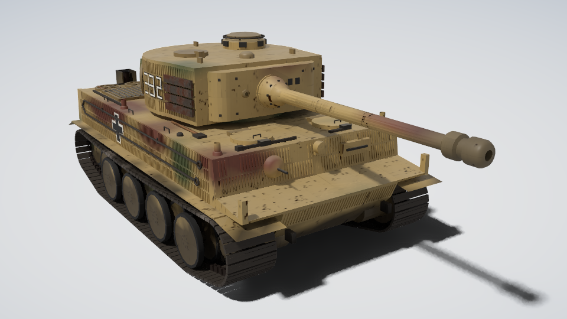</a><br><sub><a href="recipes/tiger_1/"><code>tiger_1</code></a> · Tiger I</sub></td>
    <td align="center" width="25%"><a href="recipes/loco_440/">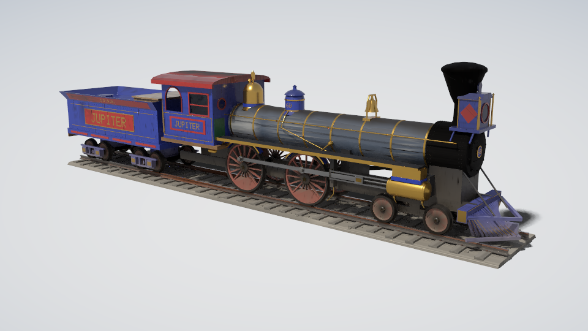</a><br><sub><a href="recipes/loco_440/"><code>loco_440</code></a> · 4-4-0 “Jupiter”</sub></td>
    <td align="center" width="25%"><a href="recipes/station_halt/">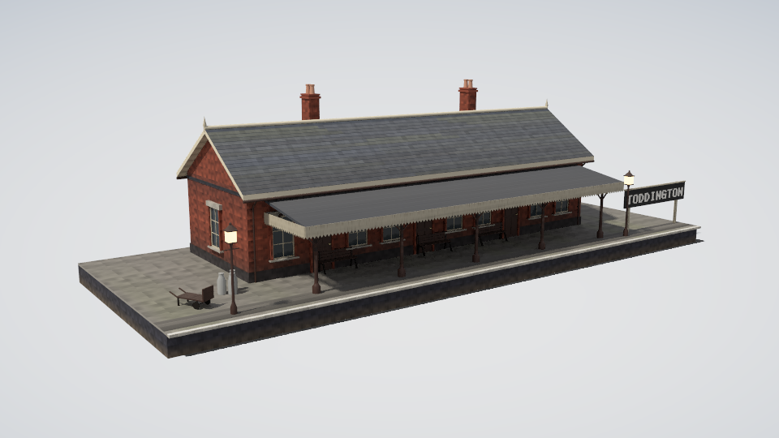</a><br><sub><a href="recipes/station_halt/"><code>station_halt</code></a> · Station halt</sub></td>
    <td align="center" width="25%"><a href="recipes/eiffel_tower/">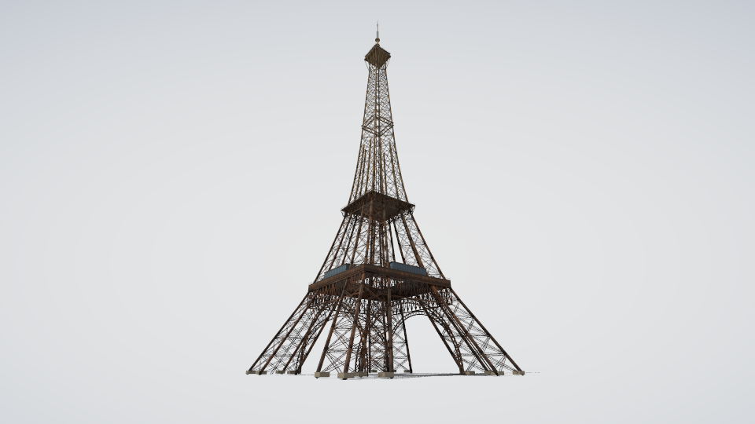</a><br><sub><a href="recipes/eiffel_tower/"><code>eiffel_tower</code></a> · Eiffel Tower</sub></td>
  </tr>
  <tr>
    <td align="center" width="25%"><a href="recipes/orc_head/">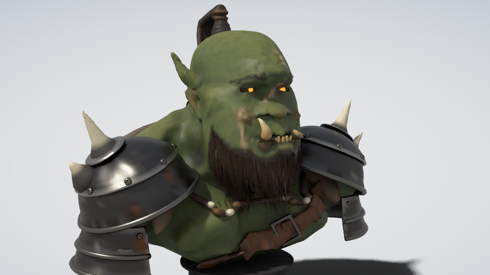</a><br><sub><a href="recipes/orc_head/"><code>orc_head</code></a> · Orc bust (sculpt)</sub></td>
    <td align="center" width="25%"><a href="recipes/goblin_head/">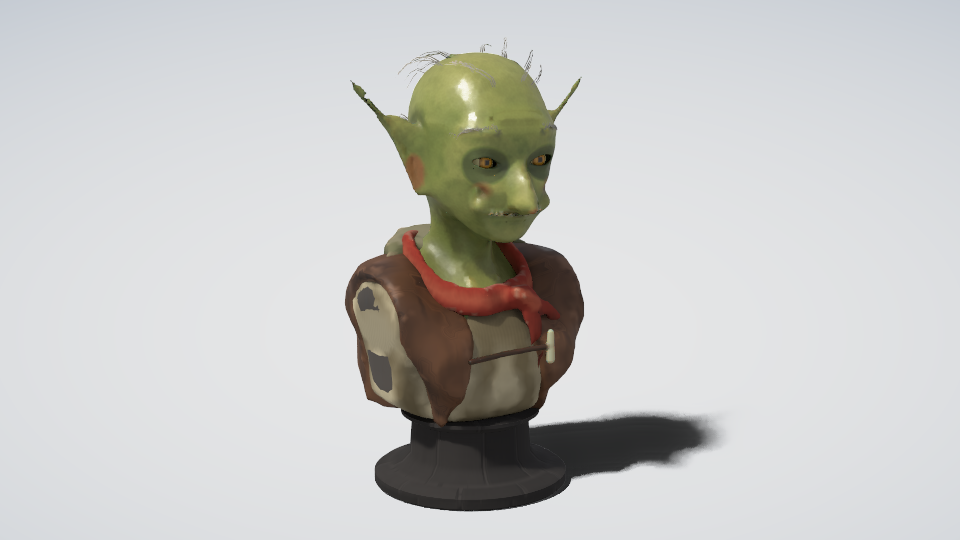</a><br><sub><a href="recipes/goblin_head/"><code>goblin_head</code></a> · Goblin bust (sculpt)</sub></td>
    <td align="center" width="25%"><a href="recipes/mountain_range/">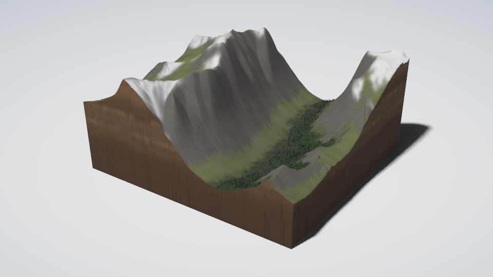</a><br><sub><a href="recipes/mountain_range/"><code>mountain_range</code></a> · Eroded mountains</sub></td>
    <td align="center" width="25%"><a href="recipes/oak/">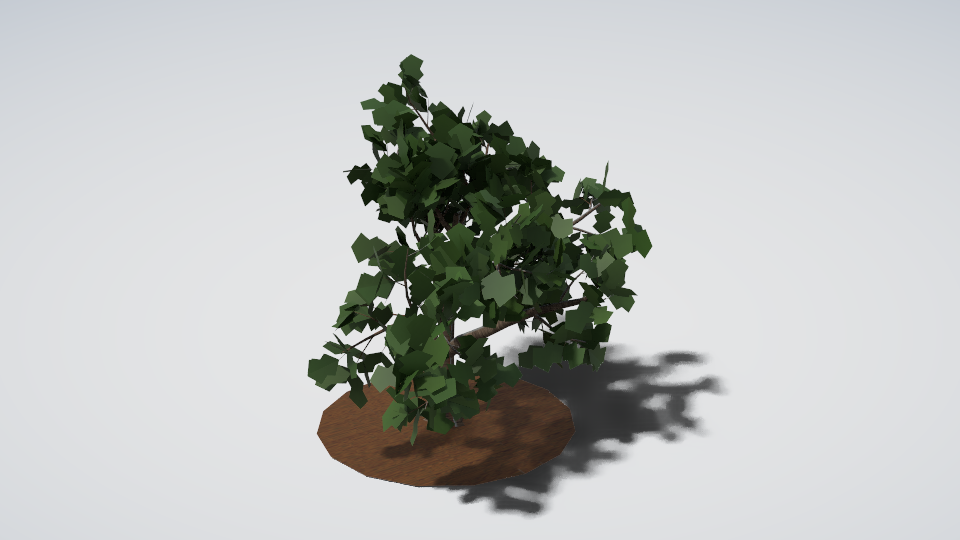</a><br><sub><a href="recipes/oak/"><code>oak</code></a> · Oak</sub></td>
  </tr>
  <tr>
    <td align="center" width="25%"><a href="recipes/water_tower/">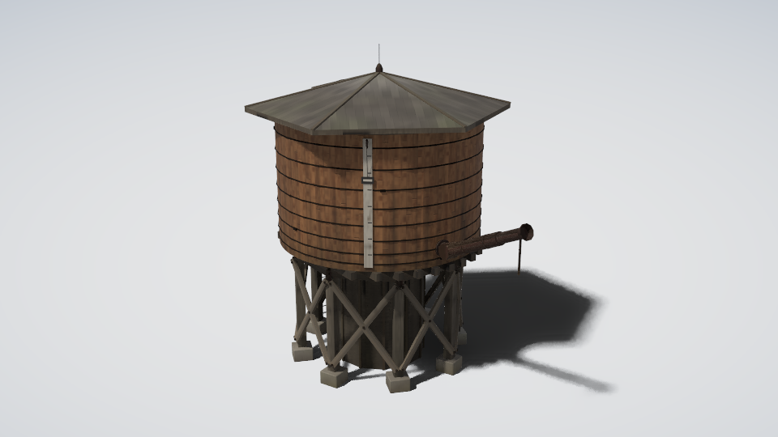</a><br><sub><a href="recipes/water_tower/"><code>water_tower</code></a> · Water tower</sub></td>
    <td align="center" width="25%"><a href="recipes/boxcar/">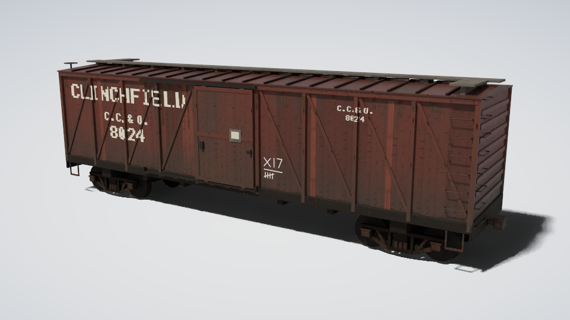</a><br><sub><a href="recipes/boxcar/"><code>boxcar</code></a> · USRA boxcar</sub></td>
    <td align="center" width="25%"><a href="recipes/signal_gantry/">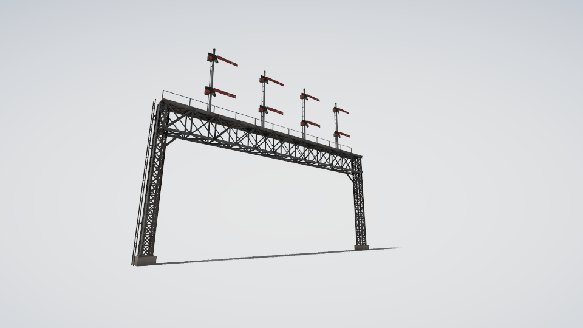</a><br><sub><a href="recipes/signal_gantry/"><code>signal_gantry_4</code></a> · Signal gantry</sub></td>
    <td align="center" width="25%"><a href="recipes/t34/">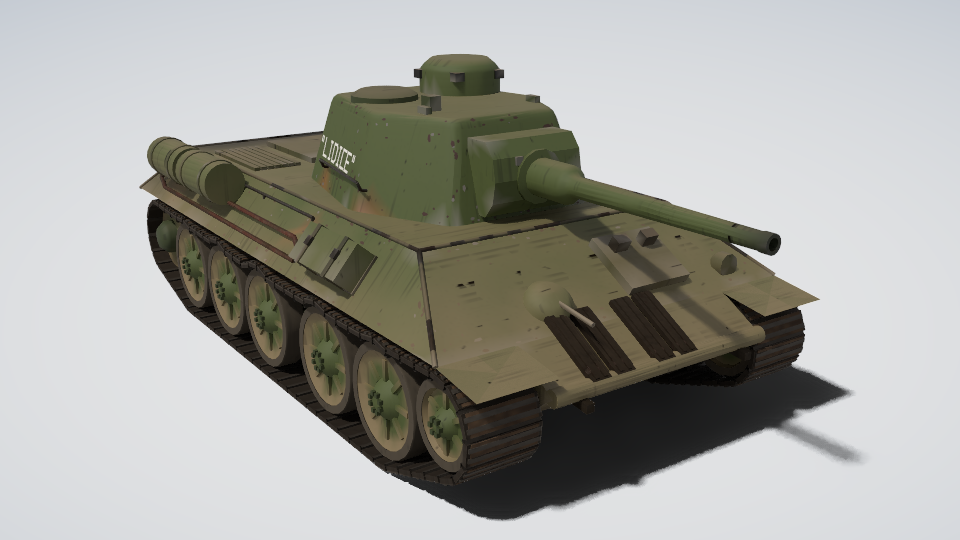</a><br><sub><a href="recipes/t34/"><code>t34</code></a> · T-34/76 1943</sub></td>
  </tr>
  <tr>
    <td align="center" width="25%"><a href="recipes/asteroid/">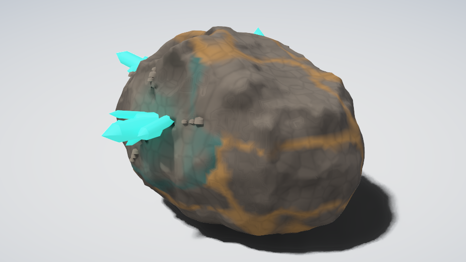</a><br><sub><a href="recipes/asteroid/"><code>asteroid</code></a> · Asteroid</sub></td>
    <td align="center" width="25%"><a href="recipes/cargo_container_scifi/">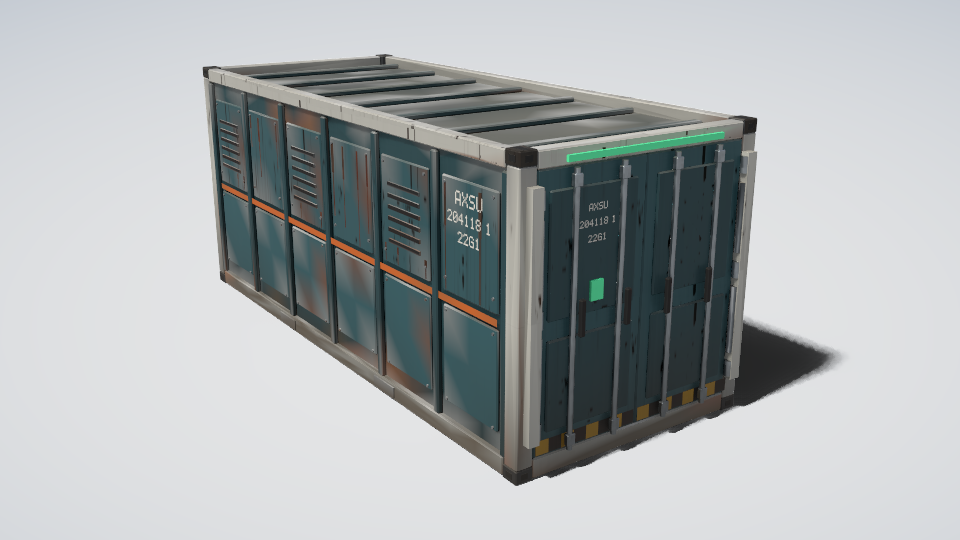</a><br><sub><a href="recipes/cargo_container_scifi/"><code>cargo_container_scifi</code></a> · Sci-fi cargo pod</sub></td>
    <td align="center" width="25%"><a href="recipes/boulders/">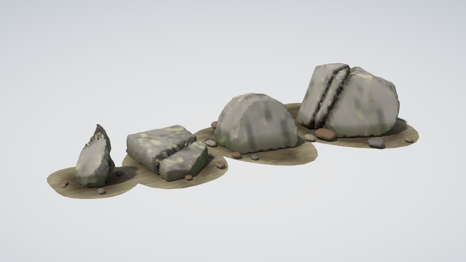</a><br><sub><a href="recipes/boulders/"><code>boulders</code></a> · Boulders (SDF)</sub></td>
    <td align="center" width="25%"><a href="recipes/dropship/">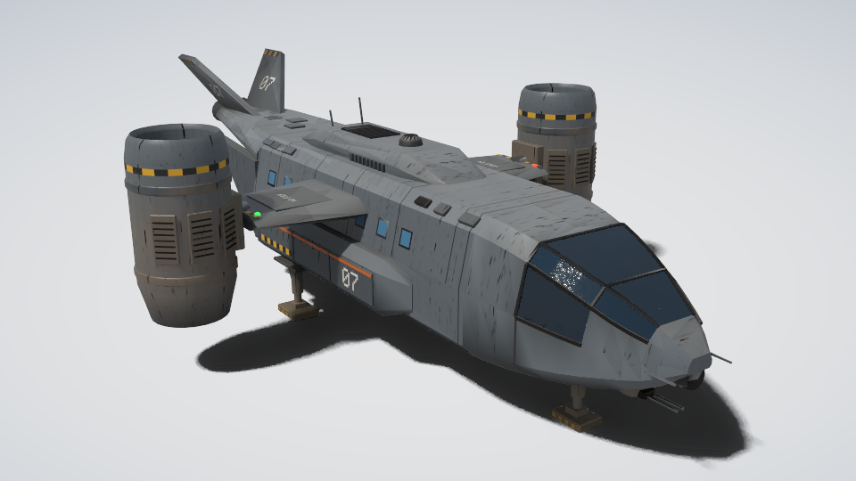</a><br><sub><a href="recipes/dropship/"><code>dropship</code></a> · VTOL dropship</sub></td>
  </tr>
</table>

<sub>Every image above is a real render: the committed <code>hero.png</code> next to each recipe, made on the CPU by <code>t3d hero</code> (regenerate with <code>bun run shots &lt;name&gt;</code>). Click one for its recipe, reference dossier and contact sheet.</sub>

**Bodies beyond four legs.** Sharks, fish, snakes, an octopus and a many-necked hydra, built from bone chains with `defineBodyPlan`. Their swim, slither, reach and strike clips are baked from published biomechanics numbers and checked by QA.

<table>
  <tr>
    <td align="center" width="20%"><a href="recipes/great_white/">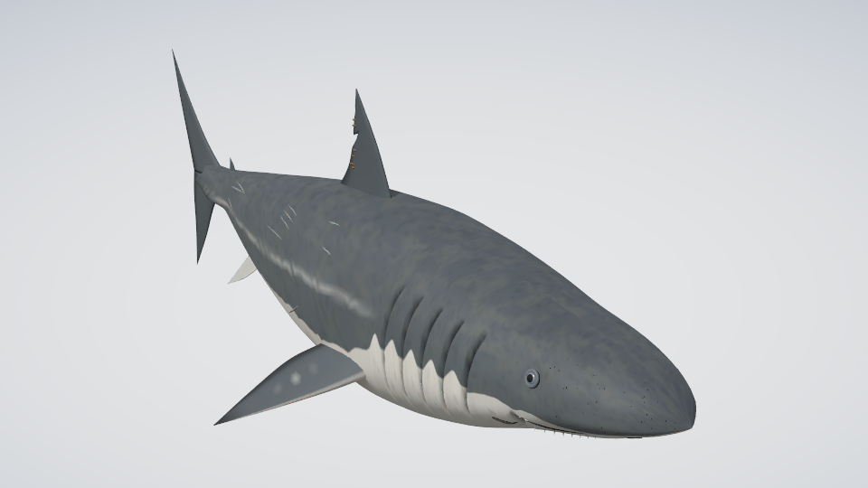</a><br><sub><a href="recipes/great_white/"><code>great_white</code></a> · Great white shark</sub></td>
    <td align="center" width="20%"><a href="recipes/bluefin_tuna/">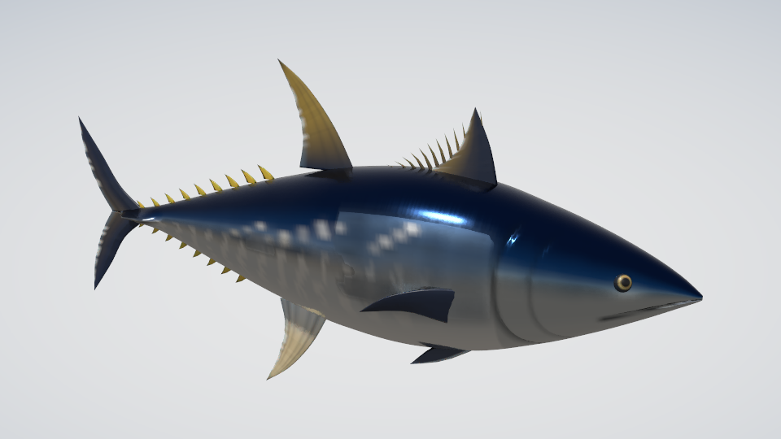</a><br><sub><a href="recipes/bluefin_tuna/"><code>bluefin_tuna</code></a> · Atlantic bluefin tuna</sub></td>
    <td align="center" width="20%"><a href="recipes/common_octopus/">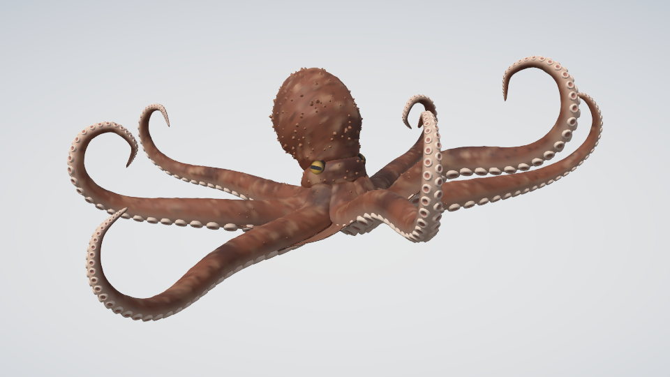</a><br><sub><a href="recipes/common_octopus/"><code>common_octopus</code></a> · Common octopus</sub></td>
    <td align="center" width="20%"><a href="recipes/king_cobra/">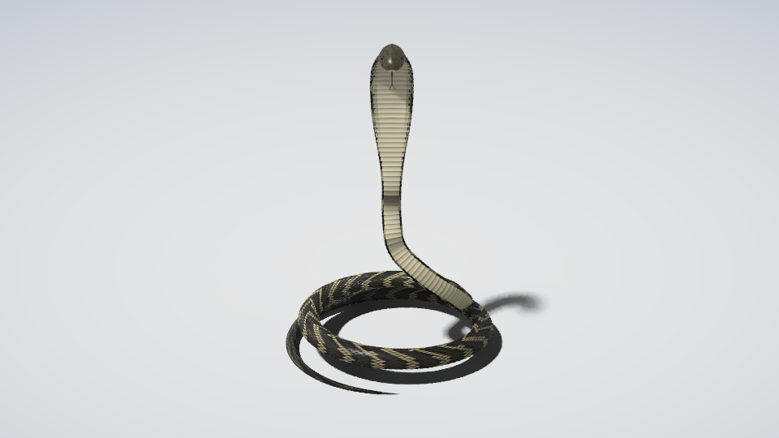</a><br><sub><a href="recipes/king_cobra/"><code>king_cobra</code></a> · King cobra</sub></td>
    <td align="center" width="20%"><a href="recipes/hydra/">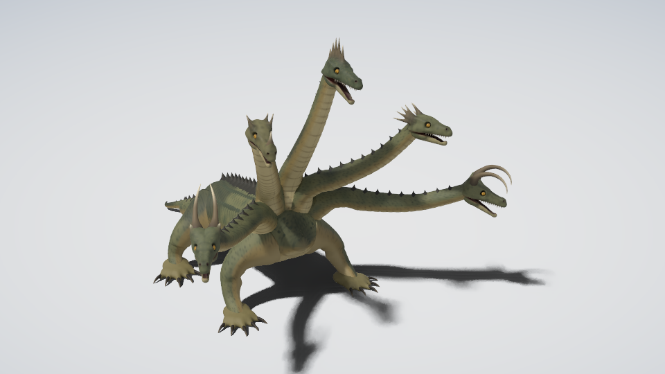</a><br><sub><a href="recipes/hydra/"><code>hydra</code></a> · Five-necked hydra</sub></td>
  </tr>
</table>

**Model tier: characters and creatures.** The same recipe loop with a model in it: an image-to-3D body (a local GPU model or [Meshy](https://www.meshy.ai)), finished by headless Blender steps the recipe writes (retopology, UVs, bake to albedo / normal / ORM, skinning, LODs), then held to real scale, a sourced skeleton, baked clips, budgets and the same QA gate. Each one ships as a skinned GLB with its own textures on three LODs (about 30–39k / 10–12k / 4–5k triangles, 1 draw call); the model outputs are committed with their licence, so builds and CI replay them without a GPU or a key.

<table>
  <tr>
    <td align="center" width="25%"><a href="recipes/ranger/">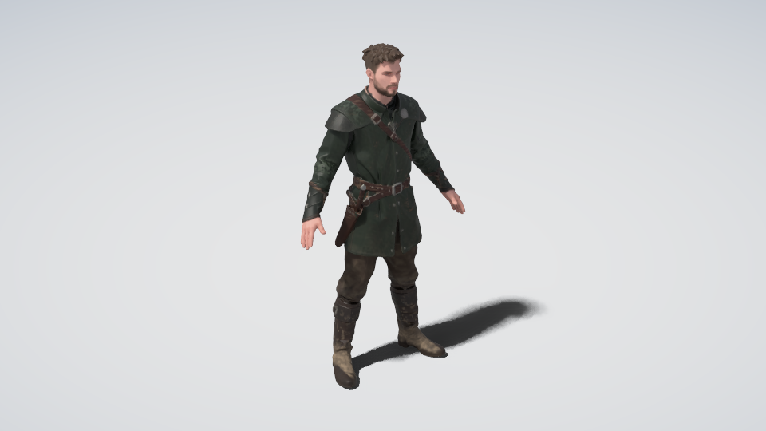</a><br><sub><a href="recipes/ranger/"><code>ranger</code></a> · Woodland ranger (Meshy)</sub></td>
    <td align="center" width="25%"><a href="recipes/dragon_hybrid/">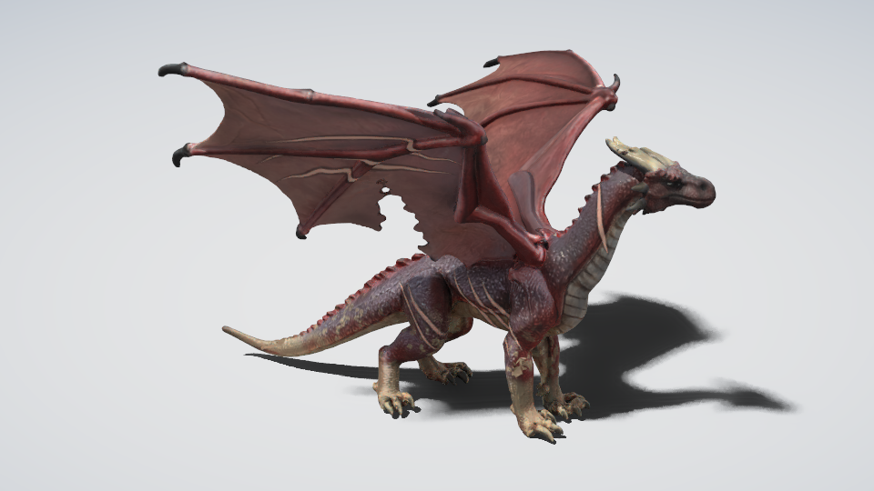</a><br><sub><a href="recipes/dragon_hybrid/"><code>dragon_hybrid</code></a> · Emberwing drake (Pixal3D + UniRig)</sub></td>
    <td align="center" width="25%"><a href="recipes/bear_hybrid/">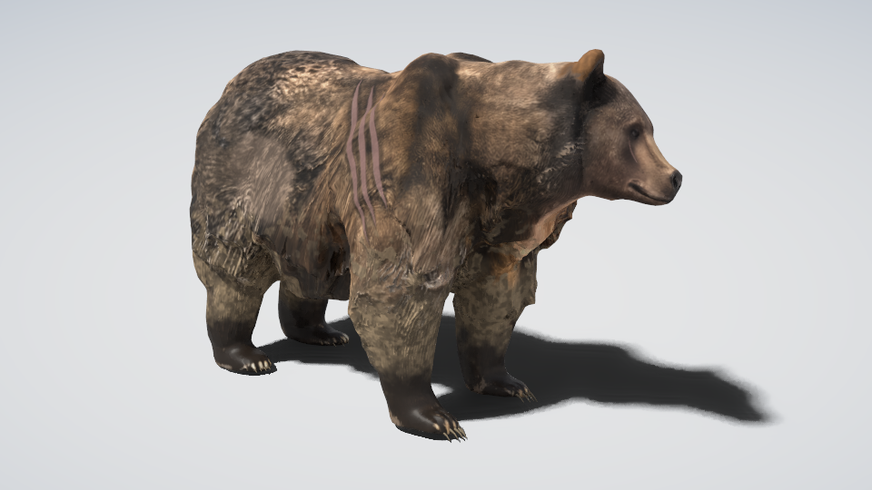</a><br><sub><a href="recipes/bear_hybrid/"><code>bear_hybrid</code></a> · Brown bear (Pixal3D + UniRig)</sub></td>
    <td align="center" width="25%"><a href="recipes/wolf_hybrid/">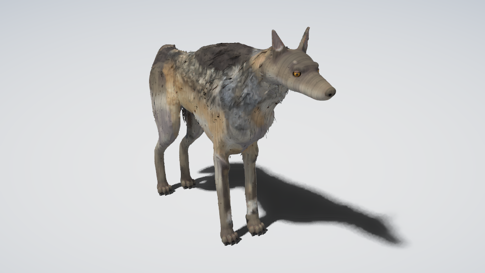</a><br><sub><a href="recipes/wolf_hybrid/"><code>wolf_hybrid</code></a> · Grey wolf (Pixal3D + UniRig)</sub></td>
  </tr>
</table>

<sub>Rendered on the CPU by <code>t3d hero</code> like every other asset. In the <a href="https://developerz-ai.github.io/ts23d/">gallery</a> these open on the Model tier; the switch shows the CPU tier, which builds without a model. Known limits and measured cost are in each recipe's README.</sub>

**Pairs well with [Meshy](https://www.meshy.ai).** Use Meshy for the image-to-3D body and rig, then let a recipe finish the result: headless Blender steps clean it, rebuild its topology, UVs and baked maps, keep its rig and clips, and write three LODs, with ts23d QA on the final GLB. [`recipes/ranger`](recipes/ranger/) is a worked example. Local GPU models use the same path.

[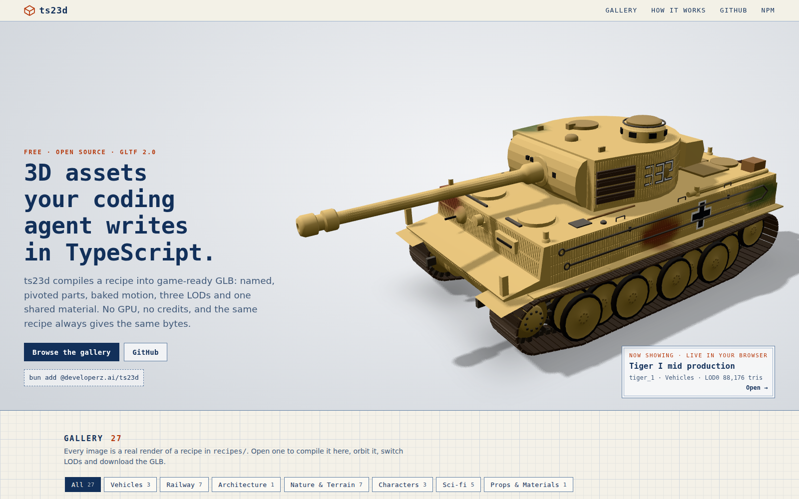](https://developerz-ai.github.io/ts23d/)

**[Open the gallery →](https://developerz-ai.github.io/ts23d/)** Every asset compiles live in your browser: orbit it, switch LOD0/1/2, toggle wireframe, play its motion or stage it in a scene, check its measures against the real thing, and download the GLB.


**Use the LLM you already pay for to write the assets your project needs (vehicles, buildings, props, whole streets), optimised by construction.** ts23d ends at the GLB, its textures and a manifest. The engine is yours.

Each asset is a TypeScript module. `t3d build` compiles it, deterministically, to GLB. Free: no GPU, no credits, no service. **[Browse the asset gallery](https://developerz-ai.github.io/ts23d/)**: every recipe, compiled in your browser, with its source.

- **Named, pivoted, animatable parts.** `turret`, `gun`, `road_wheel_l_0`: your engine code binds to node names.
- **Families.** One typed build, many assets: `family.variant({ name, params })` turns T-34 1941 into 1943 with one key; `extend` derives new families. Plain functions all the way down, no plugin API.
- **Sockets and surfaces.** `ctx.socket` exports seats, mounts, cameras and spawn points as named nodes. A part can be `opaque`, `cutout`, `glass` or `translucent`; a GLB holds at most 4 materials over one texture set (a shampoo bottle is 2 draw calls).
- **Emitters and motion.** `ctx.emitter` exports smoke, steam, dust, muzzle and fire sources as named nodes your engine's particles bind to; parts `spin`, `slide`, `sway`, `orbit` (coupling rods) or run as a slider-crank (`crank` rod, `piston`).
- **3 LODs from one source.** The recipe reads `ctx.lod` and drops detail. Nothing is decimated.
- **One shared material, batched geometry.** Every asset maps into one trim sheet, and the exporter merges static geometry into its nearest pivot. Draw calls = one per moving pivot (plus one for the merged static body): a static prop or building is 1; a tank with independently spinning road wheels is one per wheel plus turret, gun and hull. Cap it with `budget.draws`; `t3d build` fails on `T3D_QA_DRAW_CALLS`.
- **A QA gate.** Exit 1 on: a part not in surface contact with anything grounded (2 cm), a moving part that cuts through another anywhere in its motion, a blown triangle budget (and `budget.draws` when declared), non-finite or inside-out geometry, degenerate (zero-area) triangles, hidden parts, an LOD that grows instead of shrinks. Every finding carries a stable `T3D_QA_*` code, a `fix:` line and, where it applies, the gap and nearest part ([gate list](docs/idea/06-qa.md)).
- **Code-level checks.** The recipe states its physical intent and QA enforces it at every LOD: `checks: [clear('track_*', 'hull_*'), noOverlap('road_wheel_l_*'), touches('turret_body', 'hull_top'), symmetric('_l', '_r', 'y')]`. "The track hits the frame" becomes a failing build.
- **Textures from code.** A procedural albedo / normal / ORM trim sheet (bricks, planks, plates, slate, foliage), written once and shared by every GLB, plus three.js TSL and Godot shader sources.
- **Spec-sheet fidelity.** Declare `real: { length, width, height, measures }` with `sources`. QA holds the overall size to ±5% and each named dimension (driver diameter, gauge, wheelbase) to ±2%. Fix the model, never the spec.
- **A contact sheet.** One PNG, six labelled orthographic views on a metre grid, rendered on the CPU. A vision-capable agent reads it once, sees what's wrong and fixes it.
- **A beauty render and an AI review pack.** `t3d hero` renders a textured, lit, soft-shadowed 3/4 product shot on the CPU (the images above). `t3d review` writes hero, sheet, close-ups, an LOD strip, a checklist prompt for a vision agent and image metrics: QA with pictures, no GPU.
- **Organic modelling.** `sdf` (surface nets / marching cubes) with `sd.*` combinators and `sculpt`, an ordered add / subtract / paint edit list with smooth blends: busts, rocks, asteroids.
- **Draw → 3D.** An agent writes SVG (drawing as text) and ts23d builds from it: `extrudeSvg` (holes, chamfered edges), `latheSvg` (half profile), and `visualHull`, a front + side (+ top) silhouette block-out you refine with sculpt edits ([`svg_showcase`](recipes/svg_showcase/)).
- **Terrain.** Seeded noise (`fbm`, `ridged`, domain `warp`, `terrace`), droplet `hydraulicErosion` and `thermalErosion`, and `terrainColor` by altitude, slope and flow.
- **Architecture and hulls.** `roof` (gable, hip, mansard, gambrel, …), `opening` window/door kits for `facade`, true-scale masonry `mass`, lofted vessel `hull`; `tiled`, `cell` and `lattice` (Warren / Pratt / Howe trusses) primitives, `box({ bevel })`, and `text` lettering as geometry (5 × 7 pixel font, or smooth Hershey `sans`, `serif`, `script` and `gothic` stroke faces, flat or raised).
- **An optimiser on by default.** Weld, degenerate removal, vertex-cache and vertex-fetch order (tiger_1 LOD0: 15.4 → 6.3 MB, ACMR 2.88 → 1.16), weighted normals, baked per-vertex AO.
- **Lights, glow and provenance in the GLB.** `KHR_lights_punctual` from light sockets, emissive glow materials, licence / creators / sources as `KHR_xmp_json_ld`. Zero glTF-Validator warnings.
- **Physics and sound.** Per-part colliders (box, sphere, capsule, cylinder, capped convex hull), mass, centre of mass and inertia from volume × density, friction and restitution per material, exported as `KHR_physics_rigid_bodies` (`toGlb(asset, { physics: true })`); a `mass` check against `real.mass`. `@developerz.ai/ts23d/audio` synthesises deterministic impact, engine, mechanism and UI WAVs from material, size and motion, placed with `KHR_audio_emitter` ([`sound_demo`](recipes/sound_demo/)).
- **Import and faces.** `importGlb` brings in scans and CC0 base meshes (`simplify` and `bakeNormals` for those only; code-built geometry is never decimated); `importModel` keeps a model's UVs, PNG textures, skin and clips whole as a textured part on every LOD (ADR 016); `warpTPS` warps a CC0 base head onto landmarks so faces come from code ([`import_demo`](recipes/import_demo/)).
- **Tuning.** `t3d tune` fits a recipe's declared `tune.params` to objectives (silhouette IoU against an SVG or PNG mask, spec measures, art metrics, triangle budget, custom) and writes `tune.json` the recipe reads back ([`tune_demo`](recipes/tune_demo/)).
- **AI finish (optional).** `t3d finish` projects model-painted views onto LOD0 as one extra texture layer, masked per part; geometry, names and motion stay the recipe's; QA flags palette drift and mask leaks. Mock or local HTTP endpoint, cached by hash ([`finish_demo`](recipes/finish_demo/)).
- **Real data.** `@developerz.ai/ts23d/data`: `bun run data wikidata <QID>` → `realFrom` dimensions, `bun run data dem --centre lat,lon --size m` → `terrainFromDEM`; fetched once, sha256-pinned, offline builds ([`real_valley`](recipes/real_valley/)).
- **Test helpers.** `@developerz.ai/ts23d/testing`: `assertQaPass`, `assertBudget`, `assertParts`, `assertMeasure`, `assertMotionClear`, `assertDeterministic`, `snapshotHash` for your own recipe tests.

**The goal: high-definition detail up close, cheap to draw everywhere.** One texture set, batched static geometry, LODs, compact core-glTF buffers (u16 indices and colours), welded, cache-optimised meshes.

**No Blender for most hard-surface asset production.** For vehicles, buildings, props and whole scenes, the LLM writes TypeScript that does the modelling, LODs, UVs onto the trim sheet, batching, QA and export. Stylised organic shapes (busts, rocks, terrain) are code too, through `sculpt` and `sdf`; realistic sculpts come in through [`importGlb`](docs/idea/08-neural-adapters.md) (scans, CC0 base meshes) or, optionally, a model of your choice through a [`NeuralAdapter`](docs/idea/08-neural-adapters.md).

**Realistic animals and people are model-first and Blender-first** (As of 2026-11). Bodies sculpted from code primitives did not read as animals or people, so a creature or humanoid takes an image-to-3D body (a local GPU model, or [Meshy](https://www.meshy.ai) as a hosted, paid option) and finishes it with an ordered list of headless Blender steps written in the recipe: shell retopology, UVs, bake to albedo / normal / ORM, bind or keep the model's rig, LODs, review renders. The body stays whole with its textures on all three LODs ([ADR 016](docs/decisions/016-textured-parts.md)); code keeps real scale, skeleton, clips, budgets and QA (`model`, `skin`, `deform`, `gait`). Shipped: [`ranger`](recipes/ranger/README.md) (a humanoid through Meshy; its README lists the measured cost, time and known flaws) and the quadrupeds [`wolf_hybrid`](recipes/wolf_hybrid/), [`bear_hybrid`](recipes/bear_hybrid/) and [`dragon_hybrid`](recipes/dragon_hybrid/) (Pixal3D mesh and UniRig joints on one local RTX 3090, skinned to a sourced skeleton with idle, look and walk clips). Without Blender, a GPU or a key the CPU tier still builds every asset (a stand-in, not the model's look). Honest limits: fused fingers, sculpted-clump hair, no jaw or blink on a fused head. Workflow: [creature-artist](.claude/skills/creature-artist/SKILL.md) and [character-artist](.claude/skills/character-artist/SKILL.md) skills, [playbook](docs/playbooks/characters/characters-creatures.md).

## Generate assets with your agent

### 1. Install

```sh
bun add @developerz.ai/ts23d
```

Then give your agent the loop:

| Agent | Copy into your project |
|---|---|
| Claude Code | `cp -r node_modules/@developerz.ai/ts23d/.claude/skills/author-recipe .claude/skills/` (the loop) and `.claude/commands/new-recipe.md` (the `/new-recipe` command), both shipped in the package |
| Codex, others | Point your `AGENTS.md` at `node_modules/@developerz.ai/ts23d/CLAUDE.md` and `…/docs/` ([details](#use-it-with-any-agent)) |

### 2. Ask

```text
/new-recipe Tiger I, mid-production 1943, fully stowed
```
```text
/new-recipe 4-4-0 steam loco with tender, wheels and rods animated on a loop
```
```text
/new-recipe 1940s city street with townhouses and gas lamps    (townhouse, lamp, street recipes: landing)
```

The agent looks up real dimensions and photos into `recipes/<name>/README.md`, writes `recipes/<name>/<name>.ts`, builds until `QA PASS`, reads the contact sheet, and fixes the worst thing until two shots in a row find nothing ([the loop](docs/idea/05-agent-loop.md)).

### 3. Use the GLB in your engine

`out/<asset>/lod0.glb` (and `lod1`, `lod2`) are plain glTF 2.0; `out/<asset>/<asset>.glb` holds all three in one file (LOD0 in the scene, LOD1/2 as `MSFT_lod` alternates with screen-coverage switch hints; viewers without the extension show LOD0 only; `--lods split|single|both`, default both). The hooks your engine code can use:

| Hook | In the GLB |
|---|---|
| Movable parts | Named nodes with pivots at the hinge: `turret`, `gun`, `wheel_*`, `door_*` |
| Attachment points | Socket nodes with `extras.ts23d.socket` (seat, mount, camera, …) |
| Particle sources | Emitter nodes with `extras.ts23d.emitter` (smoke, steam, dust, muzzle, …) |
| Baked loop | Clip `run` (after a static `rest` clip) when built with `t3d build` |
| Everything else | `out/<asset>/manifest.json`: pivots, sockets, emitters, triangles, draw calls |

three.js, as an example:

```ts
const gltf = await new GLTFLoader().loadAsync('out/t34/lod0.glb');
const turret = gltf.scene.getObjectByName('turret');      // rotate about its local Z
const run = THREE.AnimationClip.findByName(gltf.animations, 'run');
const emitters = [];
gltf.scene.traverse((o) => o.userData.ts23d?.emitter && emitters.push(o));
```

Godot: node names import unchanged, and `extras` are available as node metadata when that import option is on. Unity (glTFast), Unreal and Babylon read the same names. ts23d ships no engine code; per-engine notes are in [glb-production.md](docs/architecture/glb-production.md#c-per-engine-import-table).

## What you get that a generated mesh doesn't

Each ts23d row names how it's verified. The image-to-3D column cites only what vendors' own pages state, as collected in [docs/landscape.md](docs/landscape.md) (as of Oct 2026). Image-to-3D is the better tool for organic and sculpted shapes; for those, see the optional [`NeuralAdapter` tier](docs/idea/08-neural-adapters.md) below.

| Property | ts23d | How it's verified | Typical image-to-3D output (per vendor docs) |
|---|---|---|---|
| Draw calls per asset | Static assets: 1. Vehicles: one per movable part (one shared material; static geometry batched into its pivot) | `toGlb` merges static parts by default (`mergeToPivots`); counts measured by `bun run bench` | One PBR material per generated model (e.g. Meshy: albedo / normal / metal / rough) |
| LODs | 3 from the same source | `t3d build` writes `lod0/1/2` plus one `MSFT_lod` file holding all three, each under its own triangle budget | One mesh per generation; polycount presets or a low-poly mode (Rodin, Meshy) |
| Named, pivoted, animatable parts | Yes | `part-names` gate; `clashes` gate sweeps every moving part | Usually one mesh; part-based output reported for CSM (3rd-party source) |
| Deterministic rebuild | Byte-identical | `scripts/recipes.ts` builds every recipe twice and compares hashes, in CI | Not stated |
| Real-world dimensions | Gated: ±5% overall, ±2% per measure | `proportions` and `measures` gates | Not stated |
| Parts that float or clash | Gated | `floating-parts` (surface contact, 2 cm), `clashes` (1 cm) | Not stated |
| Cost per asset or variant | $0 | MIT, runs locally, a variant is a new seed | Credits, e.g. Meshy ~20–25 credits per generation; Rodin $1.50/credit pay-per-result |
| GPU needed | No | CPU compile and CPU contact sheet | Hosted: no. Self-hosted open weights: yes (TRELLIS.2 ≥ 24 GB) |
| Editable by an LLM | A TypeScript diff | Code review, `bun run verify` | A binary mesh; edit by regenerating or in a DCC tool |
| Repair / retopo step | None for code-built assets: authored with pivots, units and budgets. Model-tier assets run a gated Blender `retopo` / `lods` step on the model's mesh (As of 2026-11) | QA gates fail the build instead | Remesh / retopology tools offered (Meshy Smart Topology, quad remesh; CSM AI retopology, 3rd-party) |
| Texture memory per asset | Shares one trim sheet: with `--sheet external` every GLB references the same three PNGs. Exception: a model-built part carries its own declared texture set (`budget.textureSets`, ADR 016) | `out/trim_sheet_*.png` written once per build | Own texture set per asset, up to 4K (TRELLIS.2) |

### Benchmarks

`bun run bench --write` fills the block below (triangles per LOD, compile + QA time, GLB size, parts, draw calls per gallery recipe) from real runs. Nothing in it is typed by hand; empty means not yet run.

<!-- bench:start -->
_Measured by `bun run bench` on 1.4.4 (Bun)._

| asset | tris LOD0 / 1 / 2 | GLB size LOD0 / 1 / 2 | parts | animated | draw calls (1 material) | compile + QA, 3 LODs | QA |
|---|---|---|---|---|---|---|---|
| `bluefin_tuna` | 32.3k / 4k / 476 | 1.08 MB / 150 KB / 26 KB | 8 | 0 | 1 | 498 ms | PASS |
| `common_octopus` | 134k / 13.4k / 2.09k | 6.2 MB / 729 KB / 142 KB | 6 | 0 | 2 | 4.48 s | PASS |
| `eiffel_tower` | 188k / 21.8k / 1.05k | 16.5 MB / 1.78 MB / 85 KB | 28 | 0 | 1 | 8.03 s | PASS |
| `great_white` | 61k / 7.03k / 680 | 2.1 MB / 269 KB / 35 KB | 7 | 0 | 1 | 1.17 s | PASS |
| `hydra` | 348k / 38.8k / 7.16k | 13.7 MB / 1.43 MB / 303 KB | 9 | 0 | 2 | 26.8 s | PASS |
| `king_cobra` | 62k / 3.85k / 584 | 5.02 MB / 146 KB / 33 KB | 1 | 0 | 1 | 1.92 s | PASS |
| `loco_440` | 45.3k / 18.1k / 1.4k | 2.42 MB / 967 KB / 106 KB | 84 | 14 | 18 | 1.33 s | PASS |
| `material_swatches` | 27.3k / 778 / 778 | 2.24 MB / 70 KB / 70 KB | 132 | 0 | 3 | 732 ms | PASS |
| `oak` | 13.9k / 3k / 159 | 745 KB / 166 KB / 10 KB | 6 | 1 | 2 | 10.7 s | PASS |
| `palm` | 5.57k / 2.33k / 205 | 407 KB / 196 KB / 19 KB | 6 | 1 | 2 | 1.09 s | PASS |
| `pine` | 23.7k / 5.74k / 306 | 1.16 MB / 295 KB / 36 KB | 6 | 1 | 2 | 12.5 s | PASS |
| `t34` | 48.2k / 10.4k / 1.58k | 2.63 MB / 684 KB / 163 KB | 28 | 18 | 19 | 1.94 s | PASS |
| `t34_1941` | 46.6k / 10k / 1.55k | 2.54 MB / 660 KB / 162 KB | 28 | 18 | 19 | 1.91 s | PASS |
| `tiger_1` | 72.2k / 17.4k / 3.41k | 4.36 MB / 960 KB / 288 KB | 39 | 24 | 25 | 3.28 s | PASS |
<!-- bench:end -->

Draw calls column: static assets (the Eiffel Tower) are 1; vehicles are one per movable part. Trim-sheet painting: 512² ≈ 0.22 s, 1024² ≈ 0.8 s, 2048² ≈ 2.95 s. The predecessor's reference loco (below) is about 16k triangles at LOD0.

## One asset pipeline, no other libraries

**Asset production needs nothing else between "describe the asset" and "a GLB your engine imports".** Honest status per stage:

| Stage | Module | Status (2026-10) | Replaces |
|---|---|---|---|
| Geometry | `primitives`, `kinds` | Shipped: `box` (bevel), `lathe`, `prism`, `beam`, `planar`, `sweep`, `loft`, `tiled`, `cell`, `lattice`, `text`, `heightfield`, `sdf` + `sculpt`, `warpTPS` (landmark warp of a CC0 base head), `importGlb` + `simplify` + `bakeNormals`, `terrainFromDEM`, terrain + erosion, facades with openings, roofs, hulls, vehicles, Weber–Penn trees. `creature()` (six skeletons) with bones as named parts, fur and hair cards, skinned export with named clips (walk, trot, gallop; head blink/talk/breathe) and morph targets; vector-displacement stamps; hybrid recipes. Planned: feather cards, fur shells (cards instead: glTF cannot express shells) | Blender modelling |
| Materials and textures | `material` (generator) | Shipped: procedural albedo / normal / ORM trim sheet, embedded or shared PNGs, palettes, `grime`. KTX2 export profile planned (the Basis Universal tool adapter ships, as of 2026-11) | Substance / texture tools |
| Optimisation | `passes/optimize`, `export` | Shipped: weld, degenerate removal, Forsyth vertex-cache + vertex-fetch order (ACMR reported), weighted normals, baked AO, u16 indices and colours, batching. Planned: opt-in `web` profile (quantisation + meshopt) | meshoptimizer / gltfpack |
| LODs | `ctx.lod` | Shipped | Decimators |
| QA | `qa` | Shipped: budget, surface-contact floating parts, motion clashes, names, proportions, spec measures, non-finite, winding, hidden parts, degenerate triangles, cross-LOD triangles; opt-in z-fighting, LOD silhouette and pivots. `/testing` helpers | Manual review |
| Renders and photo match | `render` | Shipped: contact sheet, beauty `hero` render (raster, or `--quality path` CPU path tracing), `review` pack for a vision agent, `photoMatch` with a camera solve, `silhouetteIoU` gate | — |
| GLB export | `export` | Shipped: faces +Z, seamless loops, trim-sheet textures, punctual lights, emissive glow, XMP provenance, 0 glTF-Validator errors and warnings (tested) | — |
| Engine import adapters | `threeMaterialSource` (TSL), `godotShaderSource` | Shipped: shader sources with wind, window glow, wear. Planned, M3: import settings and collision naming per engine, as hooks, not runtime | — |

Every stage has zero runtime dependencies ([ADR 005](docs/decisions/005-zero-runtime-deps.md)).

> **Status: early (0.x).** The core loop works: write, build, QA, shot, hero, review, with
> textures, trees, sculpt, terrain and the gallery's passing recipes. Still declared and throwing
> `T3D_NOT_IMPLEMENTED` (As of 2026-11): none in `/neural`. Flagship realism is in progress: calibrated critique scores sit near 6 of 10 (target 8.5, floor not yet enforced); hybrid heads are in progress; the wolf, bear and dragon model tiers ship (no wing motion, gallop, jaw or blink yet). Shipped neural-module pieces: `importGlb`, `importModel`, `refine`, `t3d finish --model http`, neural adapters (`http`, ComfyUI, OpenAI-compatible images, kubeez.com, Meshy, mock), the `blender` step task, the committed recipe cache with local outputs and `localGenerator`. See the [roadmap](docs/plans/roadmap.md). Expect breaking changes.

## A recipe

```ts
import { axle, box, defineAsset, palettes } from '@developerz.ai/ts23d';

const { paint, iron, trim } = palettes.victorianRail;

export const handcart = defineAsset({
  name: 'handcart',
  kind: 'vehicle',
  budget: { triangles: [2000, 800, 300] }, // LOD0 / LOD1 / LOD2 ceilings, enforced by QA
  build(ctx) {
    for (const [i, x] of [0.8, -0.8].entries()) {
      axle(ctx, { name: `axle_${i}`, at: [x, 0, 0.35], radius: 0.35, gauge: 1.2,
                  width: 0.08, color: iron, rps: 1 }); // wheels spin in the baked clip
    }
    ctx.part('bed', box({ size: [2.4, 1.3, 0.12], at: [0, 0, 0.62], color: trim, strip: 'wood' }));
    const posts = ctx.lod === 2 ? 2 : 6; // LOD drops detail; it never decimates
    for (let i = 0; i < posts; i++) {
      const x = -1.1 + (2.2 * i) / (posts - 1);
      ctx.part(`post_${i}`, box({ size: [0.08, 0.08, 0.5], at: [x, 0.6, 0.74], color: paint }));
    }
  },
});
```

Metres, Z up, +X is the front. Loops, functions and types, because a recipe is code, not data
([why](docs/decisions/002-typescript-not-json.md)).

## What the agent sees

`t3d shot recipes/tiger_1/tiger_1.ts` → `out/tiger_1/sheet.png`, from [`recipes/tiger_1/tiger_1.ts`](recipes/tiger_1/tiger_1.ts). Every recipe folder commits its sheet, hero render and manifest under `out/`:

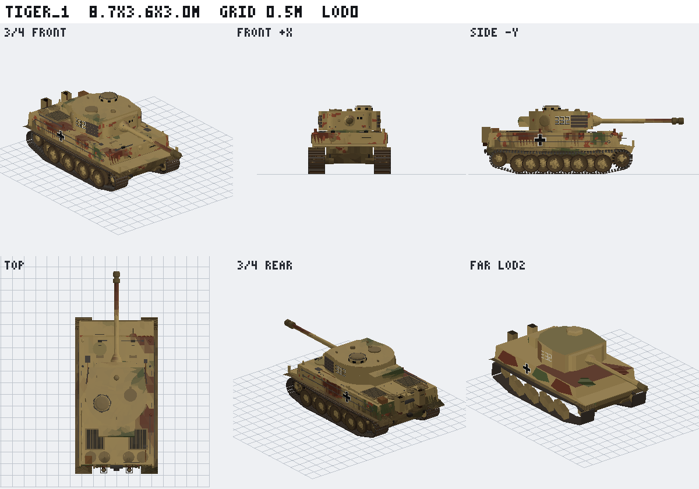

Header: name, bounding box in metres, grid step, LOD. Row 1: 3/4 front, front (+X), side (−Y).
Row 2: top, 3/4 rear, LOD2 at distance. Layout: [docs/idea/05-agent-loop.md](docs/idea/05-agent-loop.md).
`t3d hero` adds the beauty shot, and `t3d review` packs hero, sheet, close-ups, an LOD strip and a
checklist prompt into `out/<asset>/review/` for a second, fresh-eyes vision pass.

## Materials

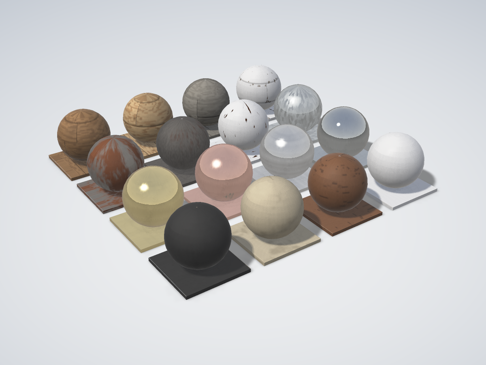

One shared 2048² trim sheet holds 24 physically based materials: oak, pine, weathered and painted
wood; rusty, cast, painted and galvanised iron and steel; brass, copper, aluminium, chrome; rubber,
canvas, leather, plastic; plus brick, stone, slate, concrete and glass. Each has its own roughness and
metalness, so chrome mirrors and wood stays matte. Projects add their own with `defineMaterial`, or
pull a CC0 photo set from Poly Haven with `bun run textures` (hash-pinned, credited in the GLB). See
[materials.md](docs/architecture/materials.md).

## Quickstart

Needs Bun ≥ 1.4.4: the CLI (`t3d`) runs on Bun. The library (`compile`, `runQa`, `toGlb`, …) also imports under Node ≥ 22 (As of 2026-11; the pack smoke test proves both). Write assets in your project, e.g. `assets/<name>.ts`.

```sh
bun add @developerz.ai/ts23d
bunx -p @developerz.ai/ts23d t3d build assets/<name>.ts       # GLB × 3 LODs + sheet + manifest per asset; exit 1 on a QA finding
bunx -p @developerz.ai/ts23d t3d shot  assets/<name>.ts       # sheet + manifest only: the fast look
bunx -p @developerz.ai/ts23d t3d hero  assets/<name>.ts       # beauty render: textured, lit, soft shadows (1600×900)
bunx -p @developerz.ai/ts23d t3d review assets/<name>.ts      # AI review pack: hero, sheet, close-ups, LOD strip, review.md
bunx -p @developerz.ai/ts23d t3d tune assets/<name>.ts --evals 400   # fit tune.params to objectives → tune.json, tune-report.md, tune-strip.png
bunx -p @developerz.ai/ts23d t3d finish assets/<name>.ts --endpoint URL --prompt "…"   # optional AI texture layer on LOD0
bunx -p @developerz.ai/ts23d t3d list  assets/*.ts --json     # the assets each module exports (one JSON envelope)
bunx -p @developerz.ai/ts23d t3d --version                    # also: t3d <command> --help
```

| Flag | Effect |
|---|---|
| `--out <dir>` | Output directory (default `out`) |
| `--no-shot` | `build` without rendering the contact sheet |
| `--sheet external\|embed\|none` | Trim-sheet textures. `external` (default): `out/trim_sheet_{albedo,normal,orm}.png` written once, every GLB references `../trim_sheet_*.png`. `embed`: inside each GLB. `none`: vertex colour only |
| `--sheet-size 512\|1024\|2048` | Sheet resolution (default 1024) |
| `--lods 0,1,2` | Which detail levels to build (default all three). `--lods 0` = hero mesh only, `--lods 0,2` = near + far. QA and the manifest cover exactly what was built |
| `--no-animations` | Skip the baked `run` clip. `t3d build` bakes it by default so viewers (e.g. VS Code glTF Tools) show play controls |
| `--json` | One envelope on stdout: `{ ok: true, data }` or `{ ok: false, error: { code, message, fix } }` (a multi-recipe run with failures also carries `data`). Errors go to stdout in this mode |
| `--timeout <s>` | `finish` only: seconds to wait for the model endpoint (default 300) |

Output, one folder per asset (stable paths for agents and pipelines):

```
out/
├── index.json              every asset built in this run, with its QA verdict
└── <asset>/
    ├── lod0.glb lod1.glb lod2.glb
    ├── hero.png            the beauty render
    ├── sheet.png           the contact sheet
    └── manifest.json       files (paths relative to the manifest) and `lods`; triangles + draw
                            calls per LOD; pivots, emitters, sockets, surfaces; real + measures
                            with measured values; sources; QA
```

Library calls differ on one default: `toGlb(asset)` exports no animation unless `{ animations: true }`.

Every exported asset in a module is built (`defineAsset` or `family.variant`). Every CLI error (missing file, throwing recipe, unknown flag, duplicate asset name) prints a stable `T3D_*` code and its `fix:`; exit 0 = ok, 1 = QA finding or build error, 2 = usage error ([errors](docs/architecture/errors.md)).

## Programmatic: no CLI, just Bun

`t3d` is a convenience. Everything it does is a function call: compile, QA, export, render.
A plain script builds exactly what you want, and the same code runs in Node ≥ 22 (against the
built `dist/`), in a browser, or in a Web Worker (the [asset gallery](https://developerz-ai.github.io/ts23d/)
compiles every recipe in a worker).

```ts
// build.ts → bun build.ts
import { compile, contactSheet, DEFAULT_SHEET, paintTrimSheet, runQa, toGlb } from '@developerz.ai/ts23d';
import { tiger_1 } from './recipes/tiger_1/tiger_1.ts';

const sheet = paintTrimSheet({ ...DEFAULT_SHEET, size: 512 }); // textures are optional

for (const lod of [0, 2] as const) {                // only the detail levels you need
  const asset = compile(tiger_1, { lod });
  const findings = runQa(asset);                    // gate it your way, or skip it
  if (findings.length) throw new Error(findings.map((f) => `${f.message} — fix: ${f.fix}`).join('\n'));
  await Bun.write(`out/tiger_1.lod${lod}.glb`, toGlb(asset, { sheet, animations: true }));
}
await Bun.write('out/tiger_1.png', contactSheet(compile(tiger_1, { lod: 0 }))); // for your agent's eyes
```

Runnable copy: [`examples/build-with-bun.ts`](examples/build-with-bun.ts) — executed in CI, so this path can't rot.

| Building block | What it gives you |
|---|---|
| `compile(asset, { lod, seed })` | the compiled parts for one LOD (deterministic) |
| `runQa(compiled)` / single gates / `inspect(compiled)` | findings with fixes; geometry queries for your own checks |
| `toGlb(compiled, { sheet, animations, keepParts })` | GLB bytes (`Uint8Array`) — write them anywhere |
| `mergeToPivots(compiled)` | the batched part list the GLB uses (draw calls = movable parts) |
| `contactSheet(compiled, { far, cell })` | six-view PNG bytes |
| `paintTrimSheet(recipe)` + `sheetPngs(sheet)` | the texture set (albedo / normal / ORM) as RGBA or PNG |
| `threeMaterialSource(hints)` / `godotShaderSource(hints)` | shader source strings for your engine |
| `manifest` data | build it from `compiled.parts` (pivots, emitters, sockets) — see `src/cli/manifest.ts` |

## Use it with any agent

**The docs ship inside the package, versioned with the code, readable offline.** After `bun add`, everything an agent needs is at `node_modules/@developerz.ai/ts23d/`: `CLAUDE.md` (the agent brain; the repo's `AGENTS.md` is a symlink to it and is not in the tarball), `llms.txt`, `docs/`, `recipes/` (worked examples), `CHANGELOG.md` and `.claude/{skills,agents,commands}`.

Point your agent at them. Add to your project's `CLAUDE.md` or `AGENTS.md`:

```md
3D assets: @developerz.ai/ts23d. Read node_modules/@developerz.ai/ts23d/CLAUDE.md first;
docs in node_modules/@developerz.ai/ts23d/docs/, example recipes in …/recipes/.
```

Claude Code skill (and the `/new-recipe` command):

```sh
mkdir -p .claude/skills .claude/commands
cp -r node_modules/@developerz.ai/ts23d/.claude/skills/author-recipe .claude/skills/
cp node_modules/@developerz.ai/ts23d/.claude/commands/new-recipe.md .claude/commands/
```


Works with any agent that writes TypeScript and can run a shell: Claude Code, Codex, Cursor, Aider, a local model. If it can read images, it closes the loop on its own. No skill files? Paste this:

```text
Using @developerz.ai/ts23d, write recipes/<name>/<name>.ts: a <thing>, real dimensions in metres,
Z up, +X front. Put the sources in `sources` and the key dimensions in `real.measures`.
Block out the masses, then details. Name every part that moves (axle_*, door_*, rotor_*)
and pivot it where it hinges. Loop until done:
  1. bunx -p @developerz.ai/ts23d t3d build recipes/<name>/<name>.ts   (fix every finding until it prints QA PASS;
     a measures finding means rebuild the part, never edit the spec)
  2. Read out/<name>/sheet.png (build writes it).
  3. Name the single biggest error, fix it, go to 1.
Stop when two consecutive shots show nothing worth fixing. Never use Math.random; use ctx.rng.
```

## For agents

**The CLI with `--json` is the interface; everything else is optional.** Each step is one command that prints one JSON envelope (`{ ok, data }` or `{ ok: false, error: { code, message, fix } }`) and writes PNGs your agent opens:

1. Write `assets/<name>.ts` exporting `defineAsset({...})`: real sizes in metres, Z up, +X front.
2. `bunx -p @developerz.ai/ts23d t3d build assets/<name>.ts --json`: fix every finding (each has a `fix:`) until QA PASS.
3. `bunx -p @developerz.ai/ts23d t3d shot …`: read `out/<name>/sheet.png`, name the single worst error, fix it, rebuild.
4. `bunx -p @developerz.ai/ts23d t3d hero …` / `blueprint …`: the textured look and the measured drawing.
5. `bunx -p @developerz.ai/ts23d t3d review …`: read `review/*.png`, follow `review.md`. Then `bunx -p @developerz.ai/ts23d t3d critique …`.
6. Add LOD-gated detail; stop when two looks in a row find nothing worth fixing.

**Skills ship in the package as plain markdown**: `node_modules/@developerz.ai/ts23d/.claude/skills/<skill>/SKILL.md`: `author-recipe` (the loop) and the artist workflows (`creature-artist`, `character-artist`, `hard-surface-artist`, `architect`, `prop-artist`, `rigger-animator`, `technical-artist`, `blender-artist`, …). Read them in place, or copy one into your agent's skills folder.

**Optional: MCP server.** `t3d mcp` serves the same steps over stdio (MCP 2025-06-18) as tools: `build`, `shot`, `hero`, `blueprint`, `review`, `critique`, `list_recipes`, `explain_error`. Renders come back as images the agent sees inline (downscaled to 1024 px; extra review images listed by path). Tools read and write only inside the project root and its output folder (`--root`, `--out`); errors come back as `T3D_*` code + fix and the server stays up.

```sh
bun add @developerz.ai/ts23d
claude mcp add ts23d -- bunx -p @developerz.ai/ts23d t3d mcp      # Claude Code, from the project root
```

Other MCP clients (Claude Desktop, Cursor, …): command `bunx`, args `["-p", "@developerz.ai/ts23d", "t3d", "mcp", "--root", "/path/to/project"]`. Use `-p`: a bare `bunx -p @developerz.ai/ts23d t3d` outside a project with the package installed fetches an unrelated npm package named `t3d`.

## Bring your own model

Optional GPU tier: any model plugs in through a `NeuralAdapter` for the tasks `image`, `mesh`, `texture`, `rig`, `motion`, `hair`, `score`. Shipped adapters: `http` (the `t3d-neural/1` protocol), `comfyAdapter` (your ComfyUI workflow), `openaiImage` (any OpenAI-compatible images endpoint) and `mockAdapter`. Name them in `t3d.config.ts`:

```ts
import { defineConfig, http } from '@developerz.ai/ts23d';
export const config = defineConfig({ neural: { mesh: http('http://gpu:8190', 'pixal3d') } });
```

`t3d neural ls` lists the models; `t3d neural run recipes/oak/oak.ts` runs what the recipe asks for and commits the outputs to `recipes/oak/neural/<key>/` with a `record.json` (model, licence, weights hash, request, output hashes; 12 MB of committed bytes per recipe, big intermediates kept local with `{ keep: 'local' }`: git-ignored, only their sha256 is committed, so a fresh clone still resolves the chain). A chain (image, mesh, rig, Blender) fills over up to 5 rounds of `t3d neural run`. Builds and CI never call a model: a hit replays the committed bytes, a miss falls back to the CPU path with a `T3D_NEURAL_MISSING` notice (an error with `--require-neural`). Every output is validated before use. Licences are recorded, never gated for your builds.

**No GPU?** For the `image` task, ts23d ships an adapter for [kubeez.com](https://kubeez.com), a hosted image-generation service. Disclosure: we work with Kubeez as a partner; any other adapter works the same way.

```ts
import { defineConfig, kubeezAdapter } from '@developerz.ai/ts23d';
export const config = defineConfig({ neural: { image: kubeezAdapter({ apiKey: process.env.KUBEEZ_API_KEY }) } });
```

The key stays in your environment: it is sent only as a request header, never written to `record.json`, the cache, logs or errors. Outputs are recorded with licence `own` and the [Kubeez terms](https://kubeez.com/legal/terms).

For the `mesh` task without a GPU, `meshyAdapter({ apiKey: process.env.MESHY_API_KEY })` runs image-to-3D (or text-to-3D from a prompt) on [meshy.ai](https://www.meshy.ai), a hosted service billed in credits; the key is handled the same way. The same adapter runs the `rig` task (rigging, plus library animation clips by name) and the `texture` task (retexture); `t3d neural run` prints the credit balance and an estimate per request and refuses a run estimated above 50 credits without `--yes-spend`. The ranger's chain cost 44 credits (30 mesh, 14 rig and three clips; measured 2026-11-16). API keys come only with paid plans, whose outputs you own: records carry licence `own`, the [Meshy terms](https://www.meshy.ai/terms-of-use) and the credits Meshy charged. A created task id is kept in `$TS23D_HOME/meshy/pending.json` until its GLB is downloaded, so a rerun after a timeout resumes the same task instead of paying again.

Details: [docs/idea/08-neural-adapters.md](docs/idea/08-neural-adapters.md), ADRs [014](docs/decisions/014-neural-outputs-are-cached-inputs.md) and [015](docs/decisions/015-models-by-adapter.md).

## Game projects and realism tools

As of 2026-11. All CPU, deterministic, no model needed unless stated.

| Command | What it does |
|---|---|
| `t3d init --engine godot\|three\|unity\|unreal\|babylon` | Scaffolds `assets/`, `style.ts`, `PLAN.md`, `t3d.config.ts` in a game project; never overwrites |
| `t3d plan check` | `assets/PLAN.md` vs recipes: missing, extra, over budget |
| `t3d build --watch` | Rebuilds changed recipes (and dependants) on save; keeps running on a failing recipe |
| `t3d hero --quality path` | Deterministic CPU path-traced beauty render (subsurface skin, hair lobes, denoise); slower than the raster default |
| `t3d finish --hero` | Hero texture tier: bakes normal, AO, height and ORM from the sculpt field onto a lighter LOD0 ([ADR 012](docs/decisions/012-hero-texture-tier.md)) |
| `t3d concept <recipe.ts\|brief.md>` | Silhouette sheet and concept images from the configured image model (needs an `image` adapter); prompts and seeds land in `concept.ts` |
| `t3d blender session start --mesh <glb>` | Keeps one Blender open: `run <batch.json>` chains steps, `undo` goes back a batch, `finish --out <program.json>` writes the steps for a clean `t3d neural run` replay, `stop` ends it |
| `t3d blender review <recipe.ts> --out <dir>` | Runs the recipe's Blender step program with a review step and writes clay, wire, weights, poses and turnaround PNGs plus `review.md` (needs Blender; `t3d setup tools`; never cached, never in a build); or `--mesh <glb> --program <json>` |
| `t3d neural run --allow-bad-input` | Sends `mesh` input images that fail the input-image rules anyway; the override is recorded in `record.json` |

Creatures export a skinned skeleton (weights from the sculpt's own bone fields, at most 4 influences) with walk, trot and gallop clips; the `skin`, `deform` and `gait` gates fail a build whose joints tear or feet slide. The gallery shows a "CPU tier / Model tier" switch for assets that have a committed model tier (textured parts included), with model and licence credits read from `record.json`.

## Optional tier

Nothing here is needed to build assets. Three commands install and run the tools and models on your own machine:

```sh
bunx -p @developerz.ai/ts23d t3d doctor            # what is here, what is missing, the exact fix for each (--json for agents)
bunx -p @developerz.ai/ts23d t3d setup gpu-full    # or: tools (no GPU) · gpu-min (8 GB+); --dry-run prints the plan first
bunx -p @developerz.ai/ts23d t3d server start      # the reference model server on 127.0.0.1:8190 (status · stop)
```

| Profile | Needs | Installs |
|---|---|---|
| `tools` | nothing | bpy 5.2.4 (Blender as a module), Godot 4.7.2 headless, basisu 2.50 (built from source), gltfpack 1.3, Material Maker 1.8 |
| `gpu-min` | NVIDIA, 8 GB+ | TRELLIS.2 GGUF through ComfyUI (low VRAM), DINOv2 scoring |
| `gpu-full` | NVIDIA, 24 GB+ | Pixal3D, TRELLIS.2, DINOv2 on torch 2.6 + CUDA 12.4 (local toolkit, no root); optional video-motion, UniRig, UniMate, HairDeck |

The Blender step task runs on the `bpy` module or a Blender app (4.5 LTS, 5.2 LTS or 5.3 accepted; the step ops were run on 5.3.0 and bpy 5.2.4); `review` renders need a machine with a GPU (checked on one RTX 3090 only). Everything lands in `~/.ts23d` (or `$TS23D_HOME`); uninstall is deleting that folder. No `sudo`, nothing system-wide; every step checks what is already there, so a re-run is a no-op and an interrupted run resumes. Downloads are version- and hash-pinned. Weights go to `$HF_HOME` (default `~/.ts23d/hf`); `HF_TOKEN` is read from your shell and never stored or printed; gated licences are listed with their URLs. GPU profiles write a `t3d.config.ts` pointing at the local server when the project has none. Linux and WSL2 today; macOS (`tools` only) is planned. No GPU: `t3d doctor` points the `image` task at kubeez.com (partner, see above); mesh, rig and motion stay on the CPU tier. The installer and server live in [`examples/neural-server/`](examples/neural-server/) (from a clone; set `TS23D_SERVER_DIR` when using the npm package).

## What fits, what doesn't

As of 2026-10. Full matrix: [docs/idea/07-what-fits.md](docs/idea/07-what-fits.md).

| Fit | Asset categories |
|---|---|
| **Strong** | Hard-surface props, architecture (facades, towers), vehicles (tracked, wheeled, rail), modular kits, anything with real dimensions or repeated parts |
| **Shipped, early** | Vegetation: Weber–Penn trees (oak, pine, palm, birch, willow); LOD2 impostors are crude |
| **Shipped, early** | Stylised organic: `sculpt` busts, SDF rocks and asteroids, eroded terrain. Boats: lofted `hull` |
| **Shipped, early** | Stylised creatures: `creature()` over a skeleton with per-family biology (`recipes/wolf`); [animal research](docs/research/animal-anatomy.md) |
| **Shipped, early** | Model-first humanoids: [`recipes/ranger`](recipes/ranger/README.md), an image-to-3D body with the rig service's skin and clips, finished by Blender steps (As of 2026-11: QA PASS; no finger bones, no blink or jaw, hair as sculpted clumps) |
| **Planned** | Model-first creatures that move more: `recipes/wolf_hybrid`, `recipes/bear_hybrid` and `recipes/dragon_hybrid` ship on the model tier (As of 2026-11); wing bones, gallop, jaw and blink on a model body are planned |
| **Weak** | Realistic people and animals as pure code. Use the model tier (a model on your own GPU or a hosted one through a `NeuralAdapter`, finished by Blender steps, `t3d neural run`), with the result committed to the recipe's cache; or an image-to-3D tool on its own |

Not a replacement for AI mesh generators: a different approach with different strengths. Neutral comparison: [docs/landscape.md](docs/landscape.md).

## Gallery

**https://developerz-ai.github.io/ts23d/**: every recipe in `recipes/`, filterable by category (vehicles, railway, architecture, nature and terrain, characters, sci-fi). The grid shows the committed renders; opening an asset compiles it in your browser with an orbit viewer, LOD switch, wireframe, its motion, a scene, named parts, measures against the real spec, the recipe source and GLB downloads.

Each recipe is a folder: `recipes/<name>/<name>.ts` (the asset), `README.md` (the reference dossier: sources, specs, photo links) and `out/<asset>/` (committed `hero.png`, `sheet.png`, `manifest.json`).

[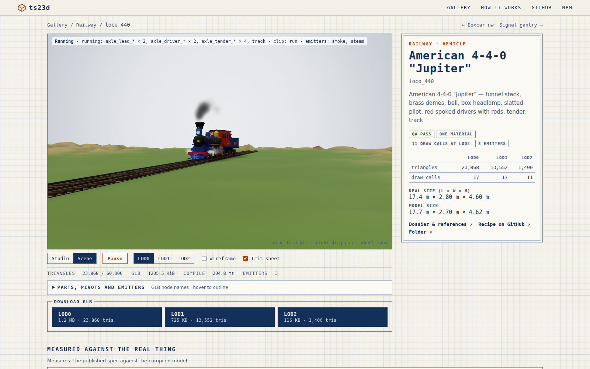](https://developerz-ai.github.io/ts23d/#loco_440)

## Docs

| Read | For |
|---|---|
| [docs/README.md](docs/README.md) | The index |
| [docs/idea/](docs/idea/01-vision.md) | Vision, DSL, IR, materials, agent loop, QA, kinds |
| [docs/decisions/](docs/decisions/README.md) | Why: ADRs with the rejected options |
| [docs/architecture/](docs/architecture/README.md) | Module tiers, adding a primitive or kind, error codes |
| [docs/plans/roadmap.md](docs/plans/roadmap.md) | M0–M6 |
| [CONTRIBUTING.md](CONTRIBUTING.md) | `bun run setup`, `bun run verify` |

## Pairs well with

| | |
|---|---|
| **[kubeez.com](https://kubeez.com)** | Partner. Generate reference and concept images, decals and texture source images. The sheet painter's image-stamped cells will consume them (planned) ([materials](docs/idea/04-materials.md)) |
| **[developerz.ai](https://www.developerz.ai)** | 100% AI-managed software engineering. ts23d is built and maintained by AI agents |

## AI-maintained

ts23d is maintained by AI: by [developerz.ai](https://www.developerz.ai), the way a human maintainer
looks after an open-source project, and built to run that way for years with no human in the loop.
The agent works publicly as `developerz-ai[bot]` and marks everything it posts as bot-made. Its
policy is committed in [`.dz/maintainer/maintainer.yml`](.dz/maintainer/maintainer.yml), and
[`CLAUDE.md`](CLAUDE.md) binds it: no policy line relaxes a rule there.

| What arrives | What happens |
|---|---|
| an issue | triaged; asked for a reproduction when one is missing; a real bug is fixed from a failing test and released |
| a pull request | reviewed, driven to a green `verify` (lint, types, boundaries, determinism, tests, every recipe's QA, pack smoke), merged |
| a recipe change | merged only with its refreshed contact sheet and hero; QA failures are fixed in the geometry, never by loosening a gate |
| Dependabot | driven to green and merged; every bump waits 14 days after upstream publishes it (security updates excepted) |
| an outside change to CI, release or publish automation | declined: the npm OIDC pipeline is the maintainers' |
| a change that breaks a rule in `CLAUDE.md` (game code, runtime deps, decimation, non-determinism) | declined with the rule quoted |

Scheduled checkups, briefs in [`.dz/briefs/`](.dz/briefs/): daily `health` catches what nothing
announces (red `main`, a gallery that did not deploy, a release npm does not serve); daily
`security-release` ships a confirmed advisory fix the same day; weekly `release-due` judges whether
users get something and cuts the release; monthly `improve` lands up to three evidenced
improvements; monthly `cleanup` sweeps branches, stale plans, weight, links, dead code, moves the
Bun pin and, each January, reviews what a year wears out. [`docs/maintenance.md`](docs/maintenance.md)
lists what decays over a decade and which lane catches each.

## Star history

<a href="https://star-history.com/#developerz-ai/ts23d&Date">
  <picture>
    <source media="(prefers-color-scheme: dark)" srcset="https://api.star-history.com/svg?repos=developerz-ai/ts23d&type=Date&theme=dark">
    
  </picture>
</a>

## License

[MIT](LICENSE). Outputs are yours: no attribution, no licence conditions on generated assets.

Third-party data in the library: the vector lettering faces (`text({ font: 'sans' | 'serif' | 'script' | 'gothic' })`) embed the Hershey fonts. The Hershey Fonts were originally created by Dr. A. V. Hershey while working at the U. S. National Bureau of Standards; the format of the font data was originally created by James Hurt, Cognition, Inc. The acknowledgements travel with the data in `src/primitives/font-hershey-*.ts`, as their licence asks; the CC0 MakeHuman hm08 head mesh behind `recipes/_lib/face` is credited the same way. Both are listed in [NOTICE](NOTICE).
