# Parts kit

<!-- generated by `bun run scripts/parts-catalogue.ts`; edit the parts, not this file -->

**Search here before you write geometry.** Each part is a `definePart` (src/core/define-part.ts):
typed params with real-scale defaults, validated, LOD-gated, cached per (params, LOD).

```ts
import { hex_bolt, hinge } from '../_parts/index.ts';
hex_bolt(ctx, 'bolt_0', { size: 'M16', length: 0.06 }, { at: [1, 0, 0.5] }); // a named part
const head = hex_bolt.mesh({ size: 'M10' }, ctx); // a mesh to place N times and merge
```

21 parts. How to define your own: [docs/idea/14-parts.md](../../docs/idea/14-parts.md).

| | Part | What | Params (default, range) |
|---|---|---|---|
| 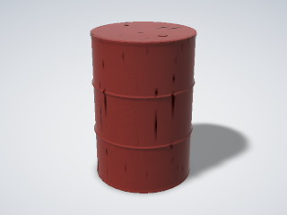 | `barrel`<br>prop, container | 200 L steel drum or coopered oak cask with iron hoops | `style` = 'steel' ('steel' \| 'wood')<br>`height` = 0.88 (0.2–2 m)<br>`diameter` = 0.585 (0.1–1.5 m) |
| 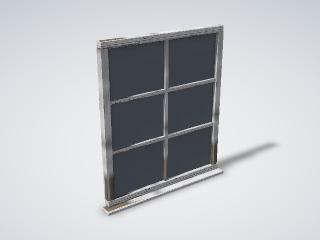 | `casement_window`<br>building, window, glass | casement window: frame, glazing bars, glass pane and sill; faces +X | `width` = 1.2 (0.3–4 m)<br>`height` = 1.4 (0.3–4 m)<br>`cols` = 2 (1–8 count)<br>`rows` = 3 (1–8 count)<br>`sill` = true |
| 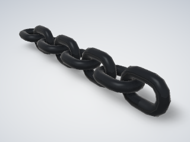 | `chain`<br>hardware, industrial | short-link chain along +X; alternate links at 90° | `links` = 8 (1–200 count)<br>`wire` = 0.01 (0.002–0.08 m) |
| 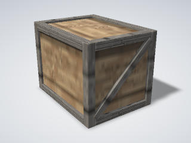 | `crate`<br>prop, container, wood | wooden crate: board box, edge battens, diagonal braces | `size` = [0.8, 0.6, 0.6]<br>`batten` = 0.06 (0.02–0.15 m) |
| 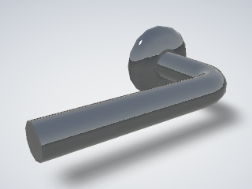 | `door_handle`<br>hardware, door | lever or knob door handle on a round rose; stands out along +X | `style` = 'lever' ('lever' \| 'knob')<br>`rose` = 0.052 (0.03–0.09 m)<br>`length` = 0.13 (0.08–0.2 m) |
| 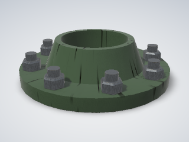 | `flange`<br>pipe, industrial, hardware | weld-neck pipe flange with a ring of bolts (nuts on the back face) | `pipe` = 0.114 (0.01–2 m)<br>`outer` = 0.22 (0.03–3 m)<br>`thickness` = 0.02 (0.004–0.2 m)<br>`bolts` = 8 (0–48 count)<br>`boltSize` = 'M16' ('M6' \| 'M8' \| 'M10' \| 'M12' \| 'M16' \| 'M20' \| 'M24') |
| 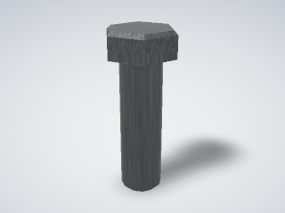 | `hex_bolt`<br>fastener, hardware, metric | ISO 4017 hex bolt: hex head on a plain shank; origin under the head (LOD ≤ 1) | `size` = 'M12' ('M6' \| 'M8' \| 'M10' \| 'M12' \| 'M16' \| 'M20' \| 'M24')<br>`length` = 0.04 (0.008–0.4 m) |
| 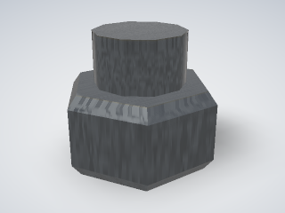 | `hex_nut`<br>fastener, hardware, metric | ISO 4032 hex nut, double-chamfered; optional thread end poking through (LOD ≤ 1) | `size` = 'M12' ('M6' \| 'M8' \| 'M10' \| 'M12' \| 'M16' \| 'M20' \| 'M24')<br>`threadEnd` = true |
| 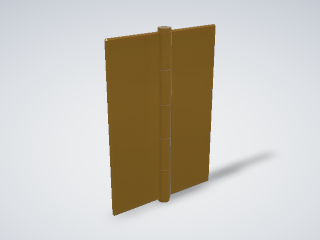 | `hinge`<br>hardware, door, moving | butt or piano hinge, open flat; the +Y leaf swings about the pin | `style` = 'butt' ('butt' \| 'piano')<br>`height` = 0.1 (0.03–3 m)<br>`leafWidth` = 0.035 (0.01–0.2 m)<br>`thickness` = 0.0025 (0.0008–0.008 m)<br>`swing` = true |
| 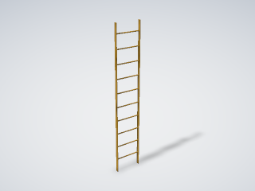 | `ladder`<br>structure, industrial, access | fixed steel ladder: flat-bar stringers, round rungs; climb face +X | `height` = 3 (0.5–20 m)<br>`width` = 0.5 (0.3–1 m)<br>`pitch` = 0.28 (0.2–0.35 m) |
| 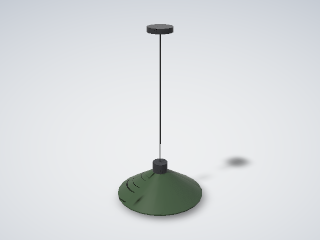 | `lamp`<br>light, industrial, glow | enamel pendant or caged bulkhead lamp; its `glow` piece is the light | `style` = 'pendant' ('pendant' \| 'bulkhead')<br>`diameter` = 0.36 (0.1–1 m)<br>`drop` = 0.6 (0.05–3 m) |
| 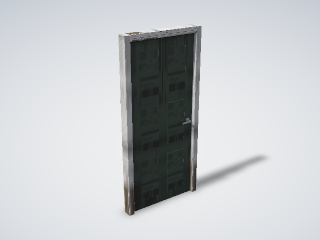 | `panel_door`<br>building, door, moving | panelled door and frame; the leaf swings about its −Y hinge edge | `width` = 0.86 (0.5–1.5 m)<br>`height` = 2.04 (1.6–3 m)<br>`thickness` = 0.04 (0.025–0.08 m)<br>`rows` = 3 (1–4 count)<br>`swing` = true |
| 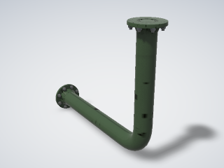 | `pipe`<br>pipe, industrial, hose | pipe with filleted bends, or a smooth hose, along a polyline; optional end flanges | `path` = [0, 0, 0, 1, 0, 0, 1, 0, 0.8]<br>`diameter` = 0.114 (0.006–2 m)<br>`style` = 'pipe' ('pipe' \| 'hose')<br>`bend` = 1.5 (0.5–10)<br>`flanges` = true |
| 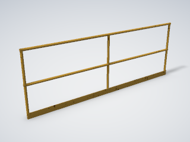 | `railing`<br>structure, industrial, safety | tubular guard railing along +Y: posts, handrail, knee rail, toe board | `length` = 3 (0.3–30 m)<br>`height` = 1.1 (0.6–1.5 m)<br>`spacing` = 1.5 (0.3–2 m)<br>`toeBoard` = true |
| 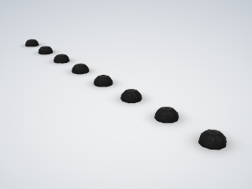 | `rivet_row`<br>fastener, hardware, detail | row of snap (round) or flat rivet heads along +X (LOD ≤ 0) | `count` = 8 (1–400 count)<br>`pitch` = 0.05 (0.005–2 m)<br>`diameter` = 0.012 (0.002–0.05 m)<br>`head` = 'round' ('round' \| 'flat') |
| 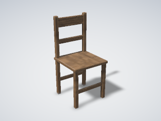 | `seat`<br>furniture, prop, wood | wooden chair or stool: four legs, seat slab, backrest | `style` = 'chair' ('chair' \| 'stool')<br>`height` = 0.45 (0.25–0.9 m)<br>`width` = 0.42 (0.25–1.2 m)<br>`depth` = 0.42 (0.25–0.8 m)<br>`back` = 0.9 (0.6–1.4 m) |
| 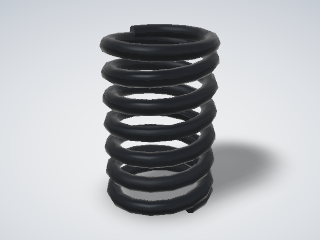 | `spring`<br>hardware, mechanical | helical compression spring with closed ends; axis +Z | `diameter` = 0.03 (0.005–1 m)<br>`wire` = 0.004 (0.0005–0.08 m)<br>`coils` = 6 (1–60 count)<br>`length` = 0.045 (0.005–3 m) |
| 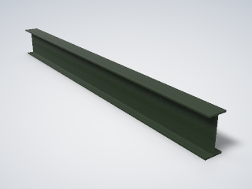 | `steel_beam`<br>structure, industrial, steel | rolled steel I-beam, channel or angle along +X | `section` = 'I' ('I' \| 'C' \| 'L')<br>`length` = 2 (0.05–40 m)<br>`depth` = 0.2 (0.02–1.2 m)<br>`width` = 0.1 (0.02–0.6 m)<br>`web` = 0.0056 (0.002–0.05 m)<br>`flange` = 0.0085 (0.002–0.06 m) |
| 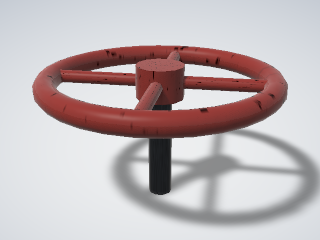 | `valve_wheel`<br>pipe, industrial, valve | valve handwheel: round rim, spokes, hub and stem; turns about Z | `diameter` = 0.25 (0.06–1.2 m)<br>`spokes` = 4 (2–8 count)<br>`stem` = 0.12 (0.01–1 m) |
| 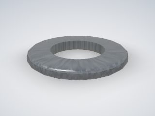 | `washer`<br>fastener, hardware, metric | ISO 7089 plain washer: flat ring sized for a metric bolt (LOD ≤ 1) | `size` = 'M12' ('M6' \| 'M8' \| 'M10' \| 'M12' \| 'M16' \| 'M20' \| 'M24') |
| 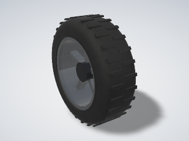 | `wheel`<br>vehicle, wheel, moving | tyre on a spoked rim with a hub; tread lugs at LOD0; spins about Y | `diameter` = 0.63 (0.1–4 m)<br>`width` = 0.22 (0.03–1.5 m)<br>`rim` = 0.43 (0.05–3.5 m)<br>`spokes` = 5 (0–24 count)<br>`tread` = true |
