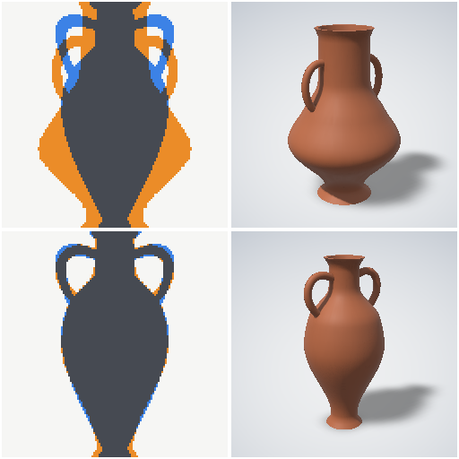

# Tuning report: tune_demo

Method cmaes, seed 1, 791 evaluations (791 compiled, the rest cached), stop: evals.
Weighted objective 0.3569 → 0.0602.
Re-run `t3d tune` with the same seed and budget to reproduce tune.json byte for byte.

## Params

| param | default | tuned |
|---|---:|---:|
| `footR` | 0.1 | 0.0665 |
| `bellyR` | 0.2 | 0.1405 |
| `bellyZ` | 0.35 | 0.495 |
| `shoulder` | 0.5 | 0.8 |
| `neckR` | 0.09 | 0.0525 |
| `neckZ` | 0.7 | 0.8325 |
| `lipFlare` | 1.1 | 1.3 |
| `handleReach` | 0.01 | 0.0305 |
| `handleTop` | 0.45 | 0.42 |
| `handleRise` | 0.03 | 0.063 |

## Objectives (lower is better)

| objective | weight | before | after |
|---|---:|---:|---:|
| silhouette +X | 1 | 0.3569 | 0.0602 (IoU 0.643 → 0.940) |

## Convergence

| gen | evals | gen best | best so far | σ |
|---:|---:|---:|---:|---:|
| 0 | 1 | 0.3569 | 0.3569 | 0.3000 |
| 5 | 51 | 0.2231 | 0.2095 | 0.2277 |
| 11 | 111 | 0.1794 | 0.1564 | 0.1791 |
| 16 | 161 | 0.1589 | 0.1301 | 0.1280 |
| 21 | 211 | 0.1140 | 0.1140 | 0.0947 |
| 26 | 261 | 0.1040 | 0.1030 | 0.0648 |
| 32 | 321 | 0.1064 | 0.0960 | 0.0654 |
| 37 | 371 | 0.0991 | 0.0895 | 0.0680 |
| 42 | 421 | 0.0898 | 0.0876 | 0.0576 |
| 47 | 471 | 0.0763 | 0.0763 | 0.0583 |
| 53 | 531 | 0.0691 | 0.0691 | 0.0499 |
| 58 | 581 | 0.0700 | 0.0691 | 0.0468 |
| 63 | 631 | 0.0674 | 0.0664 | 0.0598 |
| 68 | 681 | 0.0693 | 0.0616 | 0.0558 |
| 74 | 741 | 0.0664 | 0.0616 | 0.0474 |
| 79 | 791 | 0.0628 | 0.0602 | 0.0382 |

## Before / after

Top row before (defaults), bottom row after (tuned). Per silhouette objective: grey = both,
orange = model only (too much), blue = reference only (missing). Last column: beauty render.
