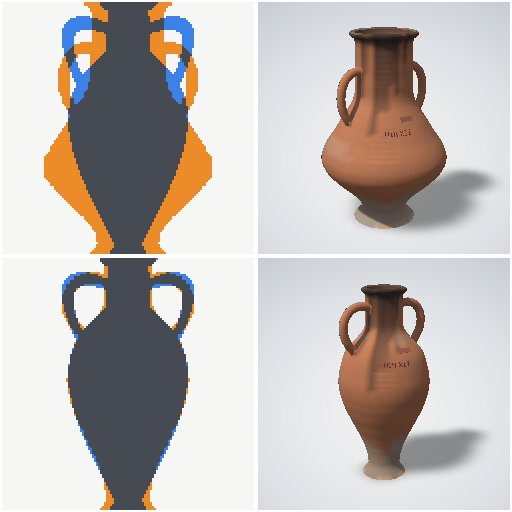

# Tuning report: tune_demo

Method cmaes, seed 1, 791 evaluations (791 compiled, the rest cached), stop: evals.
Weighted objective 0.3568 → 0.0664.
Re-run `t3d tune` with the same seed and budget to reproduce tune.json byte for byte.

## Params

| param | default | tuned |
|---|---:|---:|
| `footR` | 0.1 | 0.071 |
| `bellyR` | 0.2 | 0.143 |
| `bellyZ` | 0.35 | 0.5175 |
| `shoulder` | 0.5 | 0.78 |
| `neckR` | 0.09 | 0.058 |
| `neckZ` | 0.7 | 0.8175 |
| `lipFlare` | 1.1 | 1.09 |
| `handleReach` | 0.01 | 0.0285 |
| `handleTop` | 0.45 | 0.65 |
| `handleRise` | 0.03 | 0.0445 |

## Objectives (lower is better)

| objective | weight | before | after |
|---|---:|---:|---:|
| silhouette +X | 1 | 0.3568 | 0.0664 (IoU 0.643 → 0.934) |

## Convergence

| gen | evals | gen best | best so far | σ |
|---:|---:|---:|---:|---:|
| 0 | 1 | 0.3568 | 0.3568 | 0.3000 |
| 5 | 51 | 0.2281 | 0.2118 | 0.2306 |
| 11 | 111 | 0.2146 | 0.1778 | 0.1579 |
| 16 | 161 | 0.1643 | 0.1196 | 0.1487 |
| 21 | 211 | 0.1336 | 0.1196 | 0.0954 |
| 26 | 261 | 0.0988 | 0.0988 | 0.0959 |
| 32 | 321 | 0.0895 | 0.0865 | 0.0794 |
| 37 | 371 | 0.0847 | 0.0847 | 0.0578 |
| 42 | 421 | 0.0779 | 0.0779 | 0.0543 |
| 47 | 471 | 0.0819 | 0.0779 | 0.0435 |
| 53 | 531 | 0.0745 | 0.0745 | 0.0314 |
| 58 | 581 | 0.0698 | 0.0697 | 0.0330 |
| 63 | 631 | 0.0692 | 0.0681 | 0.0236 |
| 68 | 681 | 0.0684 | 0.0664 | 0.0196 |
| 74 | 741 | 0.0682 | 0.0664 | 0.0141 |
| 79 | 791 | 0.0668 | 0.0664 | 0.0108 |

## Before / after

Top row before (defaults), bottom row after (tuned). Per silhouette objective: grey = both,
orange = model only (too much), blue = reference only (missing). Last column: beauty render.
